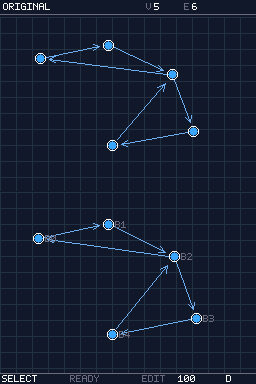

# Digraph DS

Digraph DS is a graph editor and analysis tool for Nintendo DS. Draw and move
vertices with the stylus, connect them with directed or undirected edges, and
explore the results on the second screen. Projects can be saved to SD or a
flashcart filesystem.

This is the continuation of Digraph Explorer 0.5.10, built with Rust, Bevy ECS,
and BlocksDS through [devy](https://github.com/Vjarkjan/devy). This repository
contains the application; devy provides the runtime and hardware services.



## What you can do

- Edit graphs, pan and zoom, or generate complete and random graphs.
- Explore paths, connectivity, cuts, matchings, DAG transformations, and
  game positions such as P/N and Sprague–Grundy values.
- Compare the original graph with an analysis result and apply supported
  transformations when you want to keep them.
- Save named projects, reopen them from the graph menu, and change the theme.

## Build the ROM

You need Rust, a nightly toolchain with `rust-src`, Python 3,
[Wonderful Toolchain](https://wonderful.asie.pl/), and
[BlocksDS](https://blocksds.github.io/docs/).

```bash
git clone https://github.com/Vjarkjan/digraph-ds.git
cd digraph-ds
rustup toolchain install nightly --component rust-src --component clippy
bash scripts/nds.sh rom
```

The ROM is written to `output/digraph-ds.nds`. Open it in a DS emulator or
copy it to your homebrew loader. Cargo fetches the pinned devy revision;
you do not need a separate engine checkout.

The build defaults to `/opt/wonderful` and
`/opt/wonderful/thirdparty/blocksds/core`. Set `WONDERFUL_TOOLCHAIN` and
`BLOCKSDS` if your installation is elsewhere. `NDS_TOOLCHAIN` selects another
Rust nightly, and `DIGRAPH_ARM7` can select a different compatible ARM7 binary.

## Controls

The bottom screen is the editor. Select a tool from the menu, then use the
stylus to place, select, or drag vertices. For edges, choose the edge tool and
tap the two endpoints. The upper screen shows the graph or the current result.

| Button | Action |
| --- | --- |
| A / B | Open vertex / edge tools |
| Y / X | Open algorithms / components |
| Down | Open or close the menu |
| Left / Right | Move through menu items |
| A in a menu or dialog | Confirm |
| B in a menu or dialog | Close |
| Start / Select | Zoom in / out |
| L with the menu closed | Apply the current supported transformation |
| Up outside a dialog | Clear the graph |

The `GRAPH` tab contains graph generation, view switching, statistics,
`SAVE AS...`, and `OPEN SAVED...`. Algorithms that need a source or target use
the vertices selected with `SET SOURCE` and `SET TARGET`.

## Saved projects

Storage is initialized on the first save or load. The app tries
`sd:/graph/analysis/`, then `fat:/graph/analysis/`. Your loader must provide
SD access or a working DLDI filesystem. Editing and analysis also work without
writable storage.

Named projects use `.dgxp` files and a `graphs.dgxi` index. The quick save/load
actions use `current.dgxp`. Project names accept up to 12 ASCII letters, digits,
hyphens, or underscores. Keep the index with the project files when backing up
the library.

## Development

```bash
cargo test --locked
cargo run --locked
cargo clippy --locked --all-targets -- -D warnings
bash scripts/nds.sh clippy
```

On a computer, `cargo run` initializes the editor and checks the starter graph
without opening a window. The graphical application runs in the DS ROM.

See the [code guide](Doc/README.md), [restrictions](LIMITATIONS.md), and
[validation record](Doc/verification.md) for the module layout and tested behavior.
The application grew from the local Digraph work on
[kts-nds](https://github.com/ChristopherJMiller/kts-nds); its extraction is
recorded in [Doc/origin.md](Doc/origin.md).
